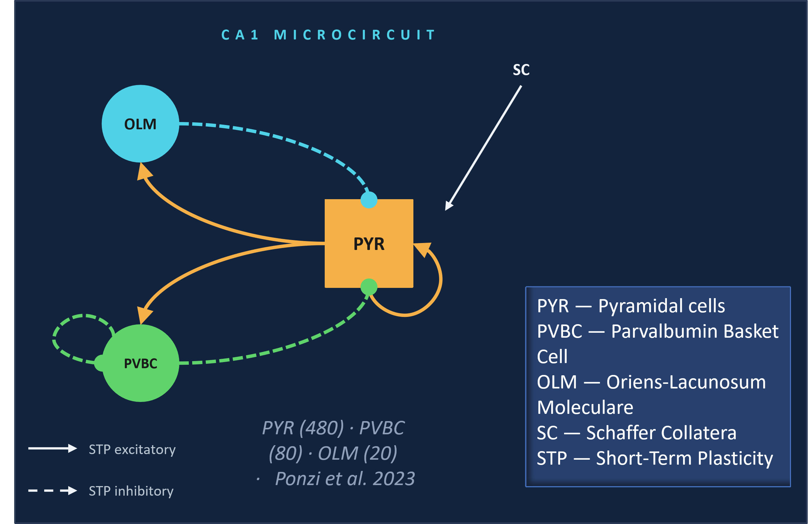

# CA1 Microcircuit — Phase-Amplitude Coupling Analysis

An interactive Jupyter notebook for submitting, retrieving, and analyzing CA1 hippocampal microcircuit simulations, with a focus on **Phase-Amplitude Coupling (PAC)** between theta and gamma oscillations.


---

## Overview

This notebook provides a complete workflow for:

1. **Job Submission** — Submit simulation jobs to UNICORE (HPC cluster) via EBRAINS
2. **Data Retrieval** — Download simulation results from remote storage
3. **Multi-Level Analysis** — Progressive analysis from spike data to PAC metrics:
   - **Level 1**: Raster plots and firing rate statistics
   - **Level 2**: Population firing rates and Power Spectral Density (PSD)
   - **Level 3**: Phase-Amplitude Coupling (PAC) comodulograms
   - **Level 4**: Comparison across parameter sweeps

The analysis reproduces key findings from **Ponzi et al. (2023)**, validating theta–gamma coupling in the CA1 circuit.

---

## Features

### Interactive Widgets
- **Job submission UI** with configuration parameter input
- **File selector** for loading multiple simulation runs
- **Parameter sweep comparison** — overlay results from different parameter values

### Analysis Outputs
- **Spike raster plots** (colour-coded by population: OLM, PVBC, PYR)
- **Population firing rates** (instantaneous and smoothed)
- **Power spectral density** — Welch's method (4 ms bins → 250 Hz sampling)
- **PAC comodulograms** — theta (1–10 Hz) × gamma (15–50 Hz)
- **PAC summary metrics** — peak coupling strength and optimal frequency pairs

---

## Requirements

### Python Environment
- Python 3.7+
- Jupyter Notebook or JupyterLab

### Dependencies
```
numpy
scipy
matplotlib
pactools
ipywidgets
pyunicore
```

### Installation

Run the setup cells in the notebook (cells 3–4) or install manually:

```bash
pip install numpy scipy matplotlib
pip install pactools
pip install ipywidgets
pip install -U pyunicore
jupyter nbextension enable --py widgetsnbextension
```

### HPC Access
- OAuth token for HPC cluster (JUSUF, Jülich Supercomputing Centre)

---

## Quick Start

### 1. Launch the Notebook
```bash
jupyter notebook tgp_ui__9_.ipynb
```

### 2. Run Cells in Order

**Section 1 (Optional): Job Submission**
- Configure simulation parameters in the interactive widget
- Submit job to UNICORE cluster
- Copy the returned Job ID for later retrieval

**Section 2: Data Retrieval**
- Enter Job IDs from Section 1 (or use pre-computed IDs)
- Download simulation results to `sim_results/` directory

**Section 3: Data Loading**
- Select `.json` files to load (Option A: downloaded results, Option B: local files)
- Data is stored in a `runs` dictionary for analysis

**Sections 4–7: Analysis**
- Run analysis cells to generate plots and metrics
- Modify parameters (e.g., frequency ranges, bin sizes) as needed

### 3. Interpret Results

#### Raster Plot (Level 1)
- Each dot = one spike
- X-axis = simulation time (ms)
- Y-axis = neuron index
- Colour = population (OLM, PVBC, PYR)

#### PSD (Level 2)
Look for:
- **Theta peak** (~4–5 Hz) — strongest in OLM
- **Gamma peak** (~25 Hz) — present in all populations

#### PAC Comodulogram (Level 3)
- X-axis = theta phase frequency (1–10 Hz)
- Y-axis = gamma amplitude frequency (15–50 Hz)
- Colour intensity = coupling strength
- Warm colours = strong coupling

#### Comparison (Level 4)
- PSD overlay for multiple runs
- Bar charts of peak PAC values and optimal frequencies

---

## File Structure

```
.
├── tgp_ui__9_.ipynb        # This notebook
├── sim_results/            # Downloaded simulation results (created on first use)
│   ├── ca1_run1.json
│   ├── ca1_run2.json
│   └── ...
└── PACSystem.png           # System workflow diagram
```

---

## Key Parameters

### Analysis Configuration

| Parameter | Default | Description |
|-----------|---------|-------------|
| `BIN_MS` | 4 | Spike binning window (ms) → 250 Hz sampling |
| `LOW_FQ_RANGE` | 1–10 Hz (0.5 Hz step) | Theta phase frequency scan |
| `HIGH_FQ_RANGE` | 15–50 Hz (2 Hz step) | Gamma amplitude frequency scan |
| `STARTTIME` | 300 ms | Discard burn-in period before analysis |

### Simulation Populations
- **OLM** — Oriens-lacunosum/moleculare interneurons (inhibitory)
- **PVBC** — Parvalbumin+ basket cells (inhibitory)
- **PYR** — Pyramidal cells (excitatory)

---


## References

**Ponzi et al. (2023)**  
*Theta-gamma coupling in the CA1 hippocampal circuit: mechanisms and functional implications*

This notebook reproduces Figures 2B, 2E–G from the above publication.

---

For questions or support:
- astrid.correa@ibf.cnr.it

---

**Last Updated**: 2026  

